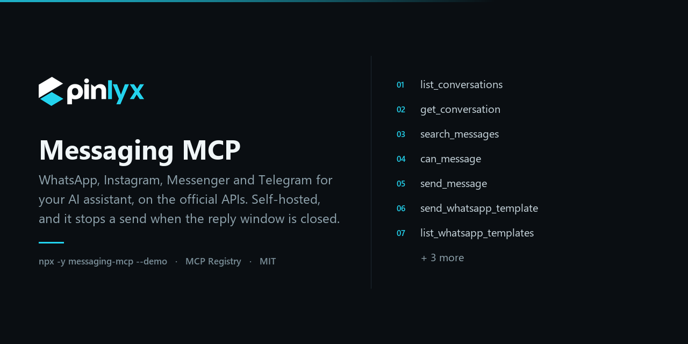

# messaging-mcp

[](https://www.npmjs.com/package/messaging-mcp) [](https://github.com/Pinlyx/messaging-mcp/actions/workflows/ci.yml) [](LICENSE) [](https://registry.modelcontextprotocol.io/v0/servers?search=com.pinlyx/messaging-mcp)



Let your AI assistant read and answer your customers' WhatsApp, Instagram, Messenger and Telegram conversations through the official APIs, with a self-hosted MCP server that stops a reply the platform would reject before it is sent.

## Why

The most popular WhatsApp MCP server on GitHub drives the unofficial WhatsApp Web protocol: your number can be banned, and the project has not been maintained since mid 2025. Business messaging has official APIs, and they come with rules the assistant has to respect:

- **Official APIs only.** WhatsApp Cloud API, the Messenger and Instagram Send APIs, and the Telegram Bot API. No scraping, no session hijacking, no ban risk from protocol abuse.
- **Four channels in one server.** One conversation list, one search, one set of tools.
- **Rule aware.** WhatsApp, Messenger and Instagram only let you reply freely inside a 24 hour window. `send_message` checks the window (using [messaging-rules](https://github.com/Pinlyx/messaging-rules)) and the channel limits first. If the reply would be rejected, nothing is sent and the assistant gets the reason, when the window closed and what is allowed instead (on WhatsApp: an approved template).
- **Tested and offline-testable.** The test suite runs without network access and without keys, and `--demo` lets you try everything with sample data.

## Try it in 60 seconds (no keys)

Add this to your MCP client configuration (Claude Desktop: `claude_desktop_config.json`, Cursor: `.cursor/mcp.json`):

```json
{
  "mcpServers": {
    "messaging": {
      "command": "npx",
      "args": ["-y", "messaging-mcp", "--demo"]
    }
  }
}
```

Claude Code: `claude mcp add messaging -- npx -y messaging-mcp --demo`

Restart the client and ask: "Which customers are waiting for an answer?" then "Reply to the German customer on WhatsApp." The demo has nine conversations on all four channels in several languages. One WhatsApp window is closed on purpose, so you see the refusal and the template suggestion. Sends in demo mode are marked `demo` and never leave your machine.

You can also try it without a client: `npx -y messaging-mcp --demo` starts the server on stdio, and `npm run smoke` (from a checkout) connects a client and calls a few tools.

Requires Node.js 22.13 or newer (it uses the built-in `node:sqlite`; on older versions the server falls back to a JSON file).

## Connect your channels

A channel turns on when its variables are set. Channels you do not configure stay off, silently.

| Channel | Variables | Guide |
| --- | --- | --- |
| WhatsApp | `WHATSAPP_ACCESS_TOKEN`, `WHATSAPP_PHONE_NUMBER_ID`, `WHATSAPP_BUSINESS_ACCOUNT_ID` (only for template listing) | [docs/setup-whatsapp.md](docs/setup-whatsapp.md) |
| Messenger | `MESSENGER_PAGE_ACCESS_TOKEN`, `MESSENGER_PAGE_ID` | [docs/setup-instagram-messenger.md](docs/setup-instagram-messenger.md) |
| Instagram | `INSTAGRAM_ACCESS_TOKEN`, `INSTAGRAM_ACCOUNT_ID` | [docs/setup-instagram-messenger.md](docs/setup-instagram-messenger.md) |
| Telegram | `TELEGRAM_BOT_TOKEN` | [docs/setup-telegram.md](docs/setup-telegram.md) |
| Meta webhooks | `META_APP_SECRET`, `META_VERIFY_TOKEN` | the guides above |
| Storage | `MESSAGING_MCP_DB` (default: your user data folder) | |

Example (Claude Desktop):

```json
{
  "mcpServers": {
    "messaging": {
      "command": "npx",
      "args": ["-y", "messaging-mcp"],
      "env": {
        "TELEGRAM_BOT_TOKEN": "123456:replace-me",
        "WHATSAPP_ACCESS_TOKEN": "replace-me",
        "WHATSAPP_PHONE_NUMBER_ID": "replace-me"
      }
    }
  }
}
```

More examples are in [examples/](examples).

### How messages get in

The platforms push (Meta) or hold (Telegram) incoming messages; this server stores them locally so the assistant can read them.

- **Telegram:** long polling with `getUpdates`, on by default. No public URL needed. Use `--telegram-webhook https://your.host` if you prefer a webhook (needs `--webhook-port`).
- **WhatsApp, Instagram, Messenger:** Meta calls a webhook. Start with `--webhook-port 8787` and expose `POST/GET /webhooks/meta` through a tunnel or reverse proxy. Every POST must carry a valid `X-Hub-Signature-256` signature (`META_APP_SECRET`), otherwise it is rejected with 401. The receiver listens on `127.0.0.1` unless you pass `--webhook-host`.
- Messages are captured only while a process is running. An MCP client starts the server when you open it, so for continuous capture run one always-on process with `--no-stdio --webhook-port 8787` and point your MCP clients at the same database with `--no-ingest` (SQLite handles the sharing).

## Tools

| Tool | What it does |
| --- | --- |
| `list_channels` | Which channels are on, the account behind each, demo and read-only state. |
| `list_conversations` | Conversations across channels, newest first. Filter by channel, unread, search; each row says whether you can reply now. |
| `get_conversation` | Messages of one conversation plus the "can I message now" summary: window state, end time, alternatives. |
| `search_messages` | Case-insensitive search over stored messages. |
| `can_message` | The rules check on its own, without sending. |
| `send_message` | Text reply. Checks length limits and the reply window first; refuses with the reason and alternatives when the platform would reject it. |
| `send_whatsapp_template` | Send an approved template (works outside the 24 hour window). |
| `list_whatsapp_templates` | Approved templates of the WhatsApp Business Account, with parameter counts. |
| `mark_read` | Clear the unread counter and, where supported, send a read receipt. |
| `get_rules` | Source-cited channel rules: windows, tags, limits, rate limits. |

Conversation = (channel, other party id): phone number on WhatsApp, PSID on Messenger, IGSID on Instagram, chat id on Telegram. All tools take plain JSON and validate it with a schema; platform errors come back as readable errors with a `code`, a `hint` and `retryAfterSec` where the platform gave one.

## Safety

- **Read-only mode:** `--read-only` does not register `send_message` or `send_whatsapp_template` at all, and `mark_read` then only clears the local counter.
- **Secrets stay in the environment.** Tokens are read from environment variables only, sent as `Authorization` headers, and scrubbed from error messages. Nothing is written to the database or the logs. (Telegram's API puts the bot token in the request path; it is redacted from every error.)
- **Data stays on your machine.** Messages are stored in a local SQLite file. The only network traffic is to the platform APIs you configured. There is no telemetry.
- **No automatic retries on sends.** A failed or rate limited send is reported, not repeated, so a customer never gets a duplicate. (Telegram's explicit `retry_after` on a 429 is honored once.)
- Webhook requests without a valid signature (Meta) or secret (Telegram) are rejected before any parsing.

An assistant can message real customers. Review what it wants to send, use `--read-only` while you evaluate, and follow the platforms' policies (opt-in for marketing templates, no spam).

## Limits

Honest list of what v0.1 does not do or has not verified:

- **X (Twitter) is not supported.** Its messaging API is paid; out of scope for v0.1.
- **Text only.** Incoming media is stored as attachment metadata (type, id, mime); there is no media download and no sending of images, documents, buttons or lists yet.
- **WhatsApp templates:** body text parameters only. Templates with header or button parameters, and named parameters, are not supported. Free-form replies work inside the 24 hour window.
- **Only conversations this server has seen.** There is no history import. If a customer wrote before the server was running, the server does not know that, and its window check errs on the side of refusing.
- **Telegram:** a bot can only write to people who started it. Updates are kept by Telegram for about 24 hours, so a short downtime is recovered when polling resumes. Edited messages are not tracked.
- **Instagram:** the send request follows the Instagram API with Instagram Login (`graph.instagram.com`). Whether `messaging_type` and `tag` are accepted on that host for the human agent tag could not be confirmed on the public documentation page we could read; that case is best-effort. Using Facebook Login tokens instead is possible with `INSTAGRAM_API_HOST=https://graph.facebook.com` but untested here.
- **Platform error mapping** (window closed, rate limited, permission, template) covers the common codes; anything else is passed through verbatim.
- **Platform rules change.** Windows, tags and limits come from [messaging-rules](https://github.com/Pinlyx/messaging-rules), which cites the official page for each value. Run `get_rules` to see the verification date. Meta retired several message tags in 2026; the rules data reflects that.
- **Graph API version** is pinned in one constant (`v27.0`, the version shown in Meta's documentation when this was written).
- Meta features that need review (App Review, business verification, display name approval, messaging limits for outbound templates) are your responsibility; the setup guides list what to expect.
- The 24 hour rule is only one of the policies. WhatsApp quality ratings, opt-in requirements and template categories are not checked by this server.

If you do not want to host this yourself, Pinlyx is the hosted version of the same idea.

## Related packages

- [unified-message](https://github.com/Pinlyx/unified-message): normalizes Telegram, WhatsApp, Instagram, Messenger and X webhook bodies and verifies their signatures. This server uses it for everything incoming.
- [messaging-rules](https://github.com/Pinlyx/messaging-rules): source-cited messaging windows, tags and limits as data, a library and a small MCP server. This server uses it before every send.

## Development

```bash
npm install
npm run build
npm test          # offline, uses recorded webhook fixtures and a mocked fetch
npm run smoke     # starts the built server in --demo mode and calls a few tools
```

See [CONTRIBUTING.md](CONTRIBUTING.md). Changes are listed in [CHANGELOG.md](CHANGELOG.md).

## License

MIT, see [LICENSE](LICENSE).

Built and maintained by [Pinlyx](https://pinlyx.com/?utm_source=github&utm_medium=readme&utm_campaign=messaging-mcp), the omnichannel inbox and AI agent for Telegram, WhatsApp, Instagram, Messenger, X, email and live chat.
